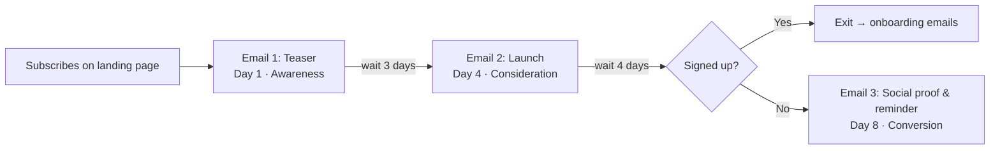

# 📧 Email Marketing Campaign — StudyNest Product Launch

A three-email launch campaign for **StudyNest**, a fictional AI study planner for college students. Built as part of the **Digital Marketing Track** to learn email marketing fundamentals: sequencing, subject lines, preview text, CTAs, and tone.

> **Note:** StudyNest, its URLs, users, and testimonials are fictional and were created for this learning task.

---

## 🎯 Task

| | |
|---|---|
| **Task** | Design a basic three-email campaign for a fictional product launch |
| **Objective** | Understand email marketing fundamentals |
| **Tools** | Mailchimp, Brevo, Google Docs |
| **Deliverables** | Three email drafts · Subject lines · Preview text · CTA · Email sequence |

---

## 🧩 The Product

**StudyNest** turns a student's syllabus and exam dates into a day-by-day study plan, with spaced-revision reminders and a weekly progress view. Free plan + paid Pro plan.

- **Audience:** Undergraduate students (18–23) who joined the pre-launch landing page
- **Goal:** Convert pre-launch subscribers into sign-ups during launch week

---

## 🔁 Email Sequence

Each email has **one purpose** and **one CTA**, moving the reader through the funnel.



| # | Email | Purpose | Send time | Subject line | Preview text | CTA |
|---|---|---|---|---|---|---|
| 1 | [Teaser](emails/01-teaser.md) | Build curiosity, grow waitlist | Day 1 · Mon 10:00 AM IST | Your study plan is about to get smarter | A quick look at what we've been building for students like you. | Join the waitlist |
| 2 | [Launch](emails/02-launch.md) | Announce + explain how it works | Day 4 · Thu 10:00 AM IST | StudyNest is live — here's how it works | Three features that turn a messy syllabus into a daily plan. | Try StudyNest free |
| 3 | [Social proof & reminder](emails/03-reminder.md) | Share user stories + gentle deadline | Day 8 · Mon 6:00 PM IST | How Priya planned her semester in 10 minutes | Real stories from our first week, plus a quick reminder about early access. | Claim 3 months of Pro |

**A/B test subject lines** (sent to 20% of the list first; the winner goes to the rest):

1. Something we've been building for exam season
2. 3 ways StudyNest turns a syllabus into a plan
3. What our first 1,000 students learned

---

## ✍️ Copywriting Principles

- **Different purpose per email** — awareness → consideration → conversion
- **No excessive promotional language** — no ALL CAPS, no "!!!", no "BUY NOW", no spam-trigger words
- **Subject lines under 50 characters** so they don't get cut off on mobile
- **Preview text adds new information** instead of repeating the subject line
- **One clear CTA button** per email
- **Personal, human tone** — written like a note from a person, signed by a team member
- **Segmentation** — Email 3 goes only to people who haven't signed up yet
- **Compliance** — every email has an unsubscribe link and explains why the reader is receiving it

---

## 📁 Repository Structure

```
email-marketing-campaign/
├── README.md
├── emails/                     # Email drafts (copy + subject + preview + CTA)
│   ├── 01-teaser.md
│   ├── 02-launch.md
│   └── 03-reminder.md
├── templates/                  # Responsive HTML emails, ready for Mailchimp / Brevo
│   ├── 01-teaser.html
│   ├── 02-launch.html
│   └── 03-reminder.html
├── docs/
│   └── campaign-strategy.md    # Audience, timing, KPIs, setup steps
└── report/
    └── Email_Marketing_Campaign_Report.pdf
```

---

## 🛠️ How to Use the Templates

**Preview:** open any file in `templates/` in a browser.

**Mailchimp**
1. *Audience → Import contacts* (CSV) and tag them `launch-list`
2. *Automations → Customer Journey*, trigger: tag added `launch-list`
3. For each email: *Code your own → Paste in code*, then set the subject line and preview text
4. Add delays (3 days, then 4 days) and a condition *"has not signed up"* before Email 3
5. Send test emails, check on mobile, then activate

**Brevo**
1. *Contacts → Import* into a list
2. *Automations → Create workflow* with the same delays and condition
3. *Email → HTML editor*, paste the template
4. Replace Mailchimp merge tags with Brevo ones:

| Mailchimp | Brevo |
|---|---|
| `*\|FNAME\|*` | `{{ contact.FIRSTNAME }}` |
| `*\|UNSUB\|*` | `{{ unsubscribe }}` |
| `*\|UPDATE_PROFILE\|*` | `{{ update_profile }}` |

**Google Docs:** the `.md` drafts in `emails/` can be pasted into a Google Doc for review and comments before building.

---

## 📊 Success Metrics

| Metric | Measures | Target |
|---|---|---|
| Open rate | Subject line + preview text | 35%+ |
| Click-through rate | Body copy + CTA | 4–6% |
| Conversion rate | Sign-ups from email clicks | 10% of clickers |
| Unsubscribe rate | Relevance & frequency | < 0.5% |

*Planning benchmarks for a warm, opted-in list.*

---

## 💡 Key Learnings

- A sequence works when every email has **one job and one CTA**.
- The **subject line earns the open**, the preview text supports it, and the **body earns the click**.
- **Helpful, plain language builds more trust than hype**, especially with students.
- **Segmentation** keeps the final email relevant and reduces unsubscribes.

---

## 👤 Author

**Sadhanala Nischay Prasad** — Digital Marketing Track
